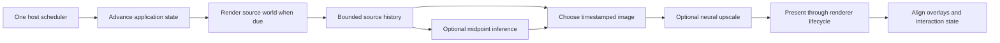

# Shared AI upscaling and frame generation

Status: implementation proposal; no runtime feature or performance gain has been
demonstrated. Date: 2026-10-12.

## Intended result

People using FOSS Earth, the UMN tour, and other applications built on the shared
renderer can independently opt into:

- **AI upscaling:** render the world at a lower internal resolution and reconstruct
  the chosen output size with a neural model.
- **AI frame generation:** generate intermediate world images for smoother motion,
  accepting additional picture delay and possible visual artifacts.

Both start off. Shared FOSS Earth packages provide the implementation, settings,
fallback and diagnostics. The first implementation targets ordinary WebGPU canvas
views; WebGL retains its existing rendering. Consumers do not need their own
inference engine or frame loop.

Proceed through measured stages. A successful upscaler can ship without frame
generation, and a successful interpolator can ship without neural upscaling.
Combining them is a later admission decision, not the starting assumption.

## Scope and evidence

This proposal follows the [research assessment](../ai-framegen-upscale.md), which
corrects the [original report](../sources/ai-framegen-upscale-original.md).
Candidate models and their limitations come from that review; they are not claims
of state-of-the-art performance or proven browser suitability.

JPEG/jpeg-js, image decoding, WASM sky, terrain selection, physics optimization
and general renderer tuning remain separate work. Only timing, capture and
presentation contracts necessary for reconstruction are in scope. Coordinate
changes to shared files with the ongoing optimization work and benchmark against
one recorded baseline. No 0SFS or UMN repository edits are needed for the initial
work. Record any consumer-only contract gap as a follow-up rather than bundling
consumer changes into the shared implementation. A later consumer change must
have a concrete requirement that cannot be addressed in a shared owner.

The source audit found one host scheduler, a renderer lifecycle that brackets
`prepare → scene.render`, and engine preparation that derives callback time from
`engine.getDeltaTime()`. The panorama viewer joins that preparation and holds
continuous rendering only while animation/inertia needs it. These are the main
integration constraints. Current source anchors, relative to the FOSS Earth
checkout group:

| Source | Relevant contract |
| --- | --- |
| `renderer/src/renderScheduler.ts` | One frame authority; `work` and rate-capped `tick`; continuous references and pause/stop generations. |
| `renderer/src/borrowedFrameClosure.ts` | Preparation/render/after-frame pairing, cancellation and owner drains. |
| `renderer/src/babylon/rendererLifecycle.ts` | Begin/end-frame, scene rendering, scaling, resize and device loss. |
| `engine/src/babylon/createGlobeRuntime.ts`, `globeRuntimePorts.ts` | Navigation, external updates, feature preparation and delta-time semantics. |
| `app/src/app/runtimeComposition.ts` | Composition over the existing scene, device and scheduler. |
| `360/src/globeBindings.ts`, `viewer.ts` | Panorama frame preparation, motion, transitions and idle behavior. |
| `renderer/src/settings/catalogue.ts`, `app/src/settings/catalogue/index.ts` | Owner-defined settings registered once in the shared registry. |

These files can change while other work proceeds. Recheck their contracts before
implementation; generated `build/ws` copies are not edit targets.

## Product behavior and settings

Create a shared **Smoothness** tab, following the
[UI layout rules](https://github.com/foss-earth/docs/blob/main/docs/ui-layout.md).
Renderer owns the parameter definitions and feature panel; app registers the tab
and settings through the existing shell/registry. Reuse generic UI controls and
the required wrapping layout. Do not add a floating overlay or duplicate these
controls in individual apps.

Proposed parameter names are design decisions, not existing exports:

| Setting | Initial values | Behavior |
| --- | --- | --- |
| `renderer.ai.upscaling` | `off` / `x2`; default `off` | Requests the admitted 2× spatial model. |
| `renderer.ai.frameGeneration` | `off` / `x2`; default `off` | Requests one generated midpoint per pair of source images. |
| `renderer.ai.bufferLimitMs` | Default 75 ms; advanced range 25–150 ms | Maximum permitted picture age in the reconstruction queue, measured from its represented source time. This is not a physical input-to-photon guarantee. |

Keep these independent of any existing “all experiments” switch, automatic
low-FPS adjustment or general performance preset. Enabling one must not enable
the other. User choices use existing preference storage; effective runtime state
is separate and must be revalidated after a device, model or output-size change.

Show effective state in the tab: off, checking, loading, warming, active, paused,
unavailable or suspended, with a plain-language reason. When active, show real
renders/s separately from presentations/s and estimated picture delay. Label
browser timing estimates honestly; do not describe a submission counter as
measured display scanout.

Suggested user explanation: “Smoother motion can make the picture respond later.
Generated images may distort during fast movement or scene changes.” Upscaling
has its own explanation: its cost can be smaller or larger than the rendering
work it saves; it does not inherently need future-frame buffering.

Do not fetch models or load inference code while both settings are off. On opt-in,
show the download size from the model manifest and keep ordinary rendering active
during initialization. Turning a setting off takes effect on the next eligible
presentation; outstanding GPU work is retired safely in the background. A failed
feature must not silently lower unrelated settings or change the user's saved
request. Recovery requiring another expensive attempt uses an explicit Retry
control in the tab.

## Ownership and proposed module layout

| Owner | Work |
| --- | --- |
| `research` | Replay/export experiments, reports and reproducible evidence; never a runtime dependency. |
| `renderer` | Inference adapter, capture/conversion, output reconstruction, queue policy, resource lifetime, feature settings and panel. |
| `app` | Bind the renderer feature to the one scheduler, settings registry, model-asset locator and shell. |
| `engine` | Explicit update time and source-preparation contracts; camera/view identity and shared presentation metadata. |
| `360` / `scenes` | View eligibility, transition/discontinuity events and any shared panorama overlay/picking adaptation. No model execution here. |
| `ui` | Existing registry, controls and tab infrastructure; new generic primitives only when required. |

Start the runtime implementation under proposed
`renderer/src/reconstruction/` for pure queue/policy contracts and
`renderer/src/babylon/reconstruction/` for GPU integration. Keep ONNX Runtime in a
lazy adapter subpath, not a static import or re-export from the pure renderer
entry. Add settings to a renderer-owned `settings/reconstruction.ts` contribution
and a renderer-owned panel using existing injected UI ports. Follow current
package conventions when choosing final filenames.

Keep the existing Babylon pin for the first experiment. No FSR pipeline or
Babylon upgrade is a prerequisite for neural inference. Introduce a separate
runtime package only if measured dependency or reuse needs justify it.

The diagram shows one combined ordering to test. Independent modes bypass the
unused stage; the final combined order is chosen by measurement.

## Frame contracts and timing

Keep application advancement, source rendering and presentation distinct, using
one host monotonic clock. Do not create another rAF authority, timer-driven
physics loop, device or scene.

For enabled reconstruction, evolve the shared frame closure to orchestrate:

1. **Advance state once when due.** Consume input and advance navigation,
   transitions and host state with elapsed time since the preceding state update.
   Preserve each owner's update policy. This must not depend on the number of
   generated images or Babylon begin/end-frame calls.
2. **Prepare and capture a real image when due.** Perform source-frame resource
   selection/preparation and world rendering once, with matching after-frame
   bookkeeping even if preparation throws. Record the represented state time.
3. **Submit eligible inference without blocking the frame callback.** Completion
   wakes the existing scheduler. Never await an inference promise inside the
   synchronous frame closure.
4. **Present an eligible ready image when due.** Bracket the final GPU work
   through the same lifecycle, with no extra scene render or host update for a
   synthetic-only presentation.

The existing `work` callback is a hidden resource-work contract, not permission
to move all scene or simulation advancement there. Add explicit coordination
ports where necessary. In particular, split panorama animation advancement from
capture-specific preparation, and replace reliance on render-driven
`getDeltaTime()` in the enabled path with explicit update time. Preserve legacy
off-mode behavior, cancellation and exception semantics in regression tests.
Reset time baselines after pause or hidden-page suspension; do not perform an
unbounded catch-up on return.

Audit Babylon's own time consumers as well as host callbacks. The installed
`Scene.animate()` uses engine delta for animation ratios and physics stepping;
particles and render observers may also depend on scene-render cadence. Calling
begin/end-frame at presentation rate while rendering the scene less often must
not slow animation, double-step a simulation or change observer semantics.
Establish a tested adapter time contract for each supported view; reject FG for
views whose Babylon-owned updates cannot be separated correctly. Do not globally
patch engine delta values to satisfy one consumer at the expense of another.

Legacy external hosts with inseparable preparation/update callbacks remain on
the existing path. Their frame generation stays unavailable until they can
satisfy the shared timing contract; this does not require editing their repos as
part of the initial work. Upscaling may still be available if capture is safe.

Proposed structural contracts:

| Contract | Required information / operation |
| --- | --- |
| `SourceFrame` | Sequence, represented time, renderer generation, view/camera identity, history revision, output and source dimensions, color descriptor and an owned image lease. |
| `FramePair` | Two ordered source frames with matching generation/view/layout and a known interval; initially only interpolation at `t = 0.5`. |
| `ReconstructionAdapter` | Prepare a pinned model on the supplied device, submit bounded work, expose output dependency/retirement handles, invalidate, dispose and drain. |
| `PresentationFrame` | Real/generated kind, represented time or endpoint pair and fraction, associated view snapshots, image lease and current validity. |
| `ViewReconstructionPolicy` | Eligibility for upscaling/FG, discontinuity revision, overlay/picking policy, temporary suspension and reason. |
| `ReconstructionStatus` | Requested/effective modes, stage timings, picture age, source/generated/repeated/dropped counts, allocation accounting and fallback reason. |

Keep WebGPU types behind the adapter boundary and pure scheduling contracts
usable without DOM libraries. Frame identity must describe the captured state,
not a mutable reference to the current camera. An inference job captures its
original generation and history revision; it cannot relabel late output with a
new generation.

### Cadence, buffering and fallback

`renderer.frameRateCap` remains the final presentation ceiling. Frame generation
selects a regular divisor of measured browser callback cadence within that cap
and its admitted device profile; source rendering targets half that rate. Avoid
claiming exact 60 or 120 FPS on an incompatible refresh cadence. Initial benchmark
configurations are 30→60 and 60→120, not minimum guaranteed speeds. No 4× mode or
extrapolation is included.

Use source timestamps, not completion order, to select the delayed presentation
timeline. A midpoint requires both endpoints; it cannot be inserted after its
later endpoint has already been displayed. Hold a fixed delay within a stable
run. Reconfigure through a fresh real frame when changing cadence or buffer
policy, rather than letting picture age grow silently.

Bound the initial queue to two retained endpoint images, one admitted inference
job and one ready generated result, plus explicitly accounted presentation
surfaces. If that capacity is occupied, skip work rather than append a promise
queue. Keep the newer endpoint for the next overlapping pair; release the older
endpoint only after its inference/presentation consumers retire. Retire the pair's
job ownership before admitting its successor, retaining the newer endpoint lease.
Include output images still used by presentation in capacity accounting; inference
promise resolution alone does not release that capacity. If it cannot sustain cadence,
reject that profile instead of quietly enlarging the queue.

For an isolated missed inference deadline, show an eligible real image or repeat
the latest still-valid presentation within the buffer limit. Count it. Never
present backwards in source time. If no image satisfies the limit, bypass to a
fresh real frame and reset history. Repeated misses suspend FG for the current
configuration; leave a separately admitted upscaler active. The same principle
applies to an upscaler that misses its budget: return to direct rendering.

One initial suspension rule is five missed target slots in a rolling two-second
window or any buffer-age violation. It is a proposed starting policy to validate,
not a measured optimum. Do not retry continuously while suspended. History reset
after an ordinary view change can warm again automatically; allocation/model
failure needs retry or a relevant configuration change.

## GPU path and model artifacts

Evaluate [Practical-RIFE 4.25.lite](https://github.com/hzwer/Practical-RIFE) for
midpoint interpolation and [RT4KSR x2](https://github.com/eduardzamfir/RT4KSR) for
single-image upscaling. Pin exact weights, implementation revisions and exported
graphs before measuring. Do not substitute a similarly named third-party ONNX
file without establishing its origin and output parity.

Each candidate needs a manifest containing source/weight/export hashes, license
and notices, conversion command/environment, graph opset, input/output names,
layout, channel/range/color assumptions, padding constraints, precision, supported
shapes, byte size and observed memory requirements. Record weights' terms
separately from code. Export RT4KSR's inference form; validate RIFE's warping
operators against the exact runtime/operator implementation used.

Use a pinned [ONNX Runtime WebGPU adapter](https://onnxruntime.ai/docs/tutorials/web/ep-webgpu.html)
on the renderer's existing device. Validate device injection before the first
session, supported operators and GPU-resident inputs/outputs. Initialization
support code is distinct from model operators: reject unexpected CPU execution
of the inference graph rather than hiding it in timing results.

The capture adapter must prove these boundaries before model integration:

- Render the world into an owned texture, preserving camera aspect, clipping,
  existing color processing and viewport behavior. Do not retain the transient
  canvas presentation texture as history. Resolve MSAA explicitly when needed.
- For x2 upscaling, compute output size from the existing DPR/resolution setting;
  render the world at half each output dimension. Keep output canvas size and
  stored `renderer.resolutionScale` unchanged. Apply model padding then crop,
  without changing projection or stretching the image. Avoid double scaling.
- Convert resolved color to the model's tensor layout on GPU. Choose and test one
  display-color convention against reference images; prevent double gamma or
  tone mapping. Initial admission covers the tested SDR color path only.
- Flush/order Babylon's producer commands before inference reads its buffers,
  and order inference output before presentation reads it. Sharing a device alone
  does not establish command-encoder ordering. Avoid CPU readback and per-frame
  `onSubmittedWorkDone()` stalls in the hot path.
- Treat output availability for ordered GPU use and actual GPU retirement as
  different events. Inference promise resolution, cancellation or disposal alone
  must not be assumed to prove that submitted work has stopped using a buffer.

Place reusable asset-loading code in the shared owner, with the app supplying a
model URL locator. Serve versioned model/runtime assets through the shared app
build; no consumer-specific URLs or automatic third-party CDN requests. A model
must not download or initialize during a root-package import.

Account for weights, tensor intermediates, source/history targets, output targets
and conversion buffers. Start with a proposed 256 MiB incremental allocation
budget per admitted profile, lowered by a host budget when necessary. Measure
the adapter's actual allocations where possible and document opaque runtime
allocations separately; an unmeasured scratch pool is not zero memory. Do not
admit a profile without a conservative bound. Allocation failures return to the
normal path without repeated allocation attempts.

Off/dispose stops new submissions immediately. Keep submitted leases until their
last consumer retires; use the existing renderer generation and owner-drain
mechanisms. Device loss invalidates publication; reinitialization uses the new
device and fresh sessions. Do not free/reuse a healthy-device input merely because
its result became obsolete. Cleanup must attempt every independent release even
if another release throws.

Draining after off/dispose is a bounded retirement state: no new jobs or result
publication, but submitted resources can remain accounted until safe to release.
The zero-session/zero-capture-resource off gate applies at cold startup and after
that drain completes, not at the instant the user clicks Off.

## Tours, interaction and discontinuities

The UMN tour is a primary workload. Test panorama look/inertia, zoom, entry/exit,
scene-to-scene navigation, image refinement, thin architecture, signage and seams.
Test globe pan/orbit, changing terrain coverage and newly visible silhouettes.
Use reusable fixtures and consumer smoke tests rather than duplicating runtime
implementation in a tour repo.

Scene identity changes, cuts, teleport, camera replacement, output-size changes,
device changes and incompatible representation changes invalidate history.
View owners issue a revision change before incompatible frames can be paired.
During complex transitions, begin with FG bypassed; enable it for a transition
only after a dedicated quality test. Do not treat every ordinary tile refinement
as a global cut, but test it and invalidate when source correspondence actually
becomes unusable.

Retain render-on-demand. When motion ends, present the bounded delayed tail, show
the final real image, release the feature's continuous work and stop inference.
Pause cancels the tail instead of keeping a hidden tab alive. Do not continually
interpolate identical panorama frames. The buffer-age limit applies while content
is advancing; a settled, unchanged final image does not expire or force refreshes.
Resume with fresh source history when motion restarts.

**Picking correctness is a release gate.** Neural interpolation can warp pixels
without producing a geometrically valid intermediate camera/depth image. A
midpoint camera matrix alone does not make world picking exact. Preserve endpoint
view snapshots and expose the presented frame's identity to overlay/picking
owners. Test scene-anchored hotspots and highlights against the visible image.

Snapshots must also address geometry lifetime. A retained camera cannot reproduce
a source frame's pick result after streamed terrain or objects have been replaced
or disposed. Supply frame-associated depth/object-ID/pick data with matching
lifetime, establish a tested immutable-scene interaction policy, or mark precision
picking unavailable for that FG view. This is interaction metadata, not a general
motion-vector requirement for the neural model.

The first live FG view must either provide a tested presentation-aware interaction
policy or declare precision world interaction incompatible and suspend FG before
that interaction mode begins. Wait for a fresh direct frame before enabling that
mode's world actions; switching the setting off does not instantly remove the
previous delayed picture. Do not silently raycast the newest world state
against an old/generated picture or queue a click and reinterpret it after the
view moves. If a view cannot meet this contract, leave its FG unavailable while
allowing compatible modes elsewhere. Normal camera motion should remain eligible
where the view's interaction policy permits it; a blanket “disable on all input”
would defeat the tour's main use case.

Keep DOM controls/text outside inference. Project scene-anchored overlays using
the admitted presentation policy; match source-image depth/occlusion when needed.
Consumers with instruments or other live-state displays choose their timing
explicitly through the shared contract. Resize and changes in window occlusion
must not reveal stale or never-rendered image regions.

WebXR/head-tracked presentation, multiple simultaneous camera views and untested
HDR paths remain outside initial admission. They require distinct timing/capture
tests rather than inheriting the ordinary canvas result.

## Implementation stages

| Stage | Deliverable and owners | Advance when |
| --- | --- | --- |
| 1. Reproducible model test | `research/scripts/benchmarks/ai-framegen-upscale/`: manifest, fixed-shape exports, reference outputs and a GPU replay harness. Use existing research output-directory/browser helpers; scratch results go under `build/`. | For each advancing candidate, output parity and operator/device compatibility are established. A failing candidate does not block the other. |
| 2. Cost and quality screen | Research report with matched controls and per-device/per-resolution results; check in selected evidence under `benchmarks/ai-framegen-upscale/`, with provenance. | At least one candidate passes replay quality, a conservative memory bound and a plausible full-path cost budget. Integrated lifecycle, timing and picking gates belong to stages 4–5. Record rejection reasons for others. |
| 3. Shared capture and timing seam | Renderer/app/engine contracts, fake-clock tests and real WebGPU capture→present validation. No model required to exercise this path. | Legacy off path passes; source/display timestamps, frame closure, color and idle behavior are correct. |
| 4. Independent opt-in features | Lazy adapters, shared Smoothness tab, effective-state reporting, bounded resources, fallback and transition policy. Upscaling can be integrated before the FG timing/picking seam is complete. | Each mode passes integrated load tests and its applicable interaction/lifecycle tests. |
| 5. Consumer validation | Shared panorama and globe fixtures plus UMN tour smoke testing against the shared build. Record consumer-only gaps as separate follow-ups; keep this implementation in the shared owners. | User-visible smoothness/quality benefits survive the real workload; no incorrect actions or timing regressions. |
| 6. Combined mode, if justified | Compare SR→FG against FG→SR, include both conversions and contention, then admit the winning configurations. | Combined mode independently passes. Otherwise expose only the independently successful features. |

Implement stages in small reviewable changes. Stage 1 is the immediate coding
task; stages 3–6 are contingent on evidence, not an instruction to build every
path regardless of results. Export tooling, runtime code, fixtures and owner
contracts follow their own package conventions. Add new research tools to
`tools-manifest.json` only when those tools actually exist.

## Measurements and proposed acceptance gates

Record exact source/package/model hashes, hardware/browser/driver, output pixels,
source pixels, observed callback cadence, existing settings and model precision.
Use fixed replay content so changing map downloads cannot masquerade as a model
speedup. Measure cold loading separately from warm inference. Repeat shortlisted
profiles three times for 60 seconds after warmup, then run a five-minute combined
render/inference workload to expose sustained contention and growth.

Compare native output; ordinary reduced-resolution scaling; reduced source
cadence with repeated frames; neural SR alone; FG alone; and finally combined
mode. Include a no-model replay of the reconstruction plumbing. Non-neural
upscaling is a control, not a separate optimization project.

These numbers are **proposed initial gates**, adjustable only with recorded
reasoning; they are not existing measurements or guarantees:

| Gate | Initial criterion |
| --- | --- |
| Model correctness | Export output matches a stored reference within a declared precision-specific tolerance; no unsupported or hidden CPU graph execution. |
| Initial/settled off behavior | No model download/session, capture target or reconstruction work after safe retirement; no extra animation authority or retained continuous reference. Warm baseline p95 frame cost must stay within 5% in repeatable comparisons, accounting for noise. |
| Upscaling benefit | At the same output dimensions, at least 10% lower integrated GPU work per real frame than native rendering on an admitted GPU-bound profile, with acceptable sequence quality and a recorded comparison against ordinary scaling. Model-only speed is insufficient. |
| FG throughput | At least 95% of target presentation slots carry distinct, correctly ordered real/generated images over the warm run; real source rate remains at least 95% of its target. Separately count repeats, skips and drops. |
| Pacing/headroom | Proposed p95 submitted-frame interval ≤1.25× target interval, p99 ≤2×; p95 total serialized GPU work per source interval ≤80% of that interval. Also inspect dependency deadlines; these aggregate gates alone do not prove scanout pacing. |
| Latency | Queue picture age stays within the chosen limit. Report added input-to-visible delay versus matched off mode; label software proxies, and use external/capture-based measurement before claiming physical input-to-photon latency. |
| Memory/lifecycle | Accounted/conservatively bounded incremental footprint fits the profile budget; no persistent growth over the sustained run; every stale result is rejected and every owned resource eventually retires or is invalidated by actual device loss. |
| Visual/interaction | Reference sequences and human inspection show no unacceptable warping, seams, temporal flicker or signage damage; hotspot/selection tests produce no incorrect actions. Document accepted artifacts per admitted mode. |

For combined FG→SR, the initial serialized-work screen is
`R_low + G_low + 2U + 2P + C < 1000/sourceFPS`, with rendering, midpoint generation,
two upscales, two presentations and all conversion/other costs counted. The 80%
headroom gate tightens that bound. Buffering cannot compensate for insufficient
sustained throughput; do not admit a mode solely because it eventually produces
enough frames in an offline test.

Use fake clocks and controlled completion order to test monotonic presentation,
missed deadlines, queue overflow, pause/resume, off during inference, late model
load, resize, stale generations, re-entrant teardown and cleanup failures. Use
real WebGPU tests for command ordering, color/MSAA/alpha, conversion, padding and
device loss. Mocked tests cannot establish GPU compatibility or performance.

Instrument source renders, state updates and presentations separately. Existing
engine metrics and readiness/terrain bookkeeping must not count a generated
image as a fresh world render or new geometric evidence. Keep model download and
warmup metrics separate from sustained source/presentation timing.

## Completion and handoff

An experimental release is complete only for the modes, resolutions and view
types with evidence: shared settings and status work, off/fallback is immediate,
timing and interactions are correct, idle behavior is preserved, and consumer
smoke tests pass. Keep both defaults off. Publishing is outside this proposal.

The first implementation handoff is to create the replay/export harness in
`foss-earth/research`, starting with a small fixed shape before testing 720p and
1080p output profiles. Return the manifests, reference-parity results, full-path
timings and a per-candidate advance/stop recommendation. Do not begin broad
renderer changes merely because a neural model can load.
